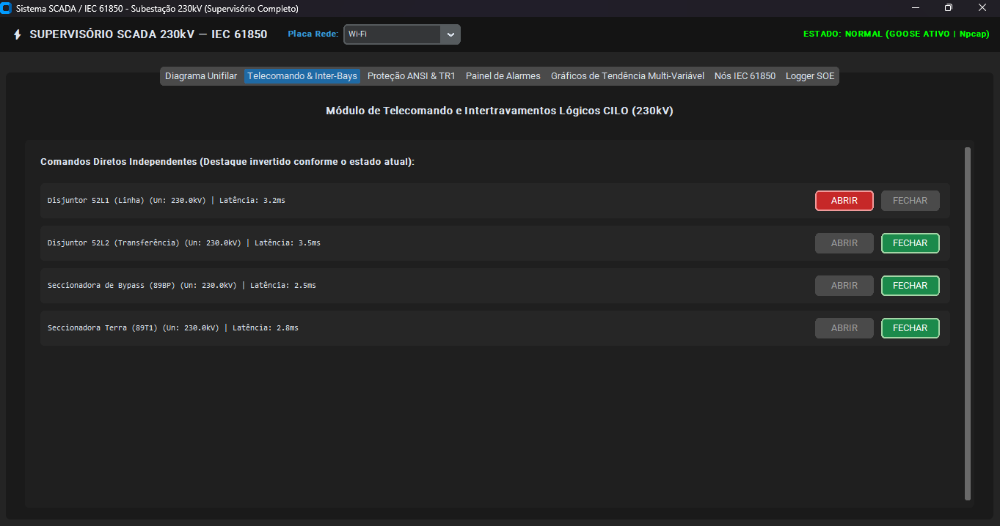
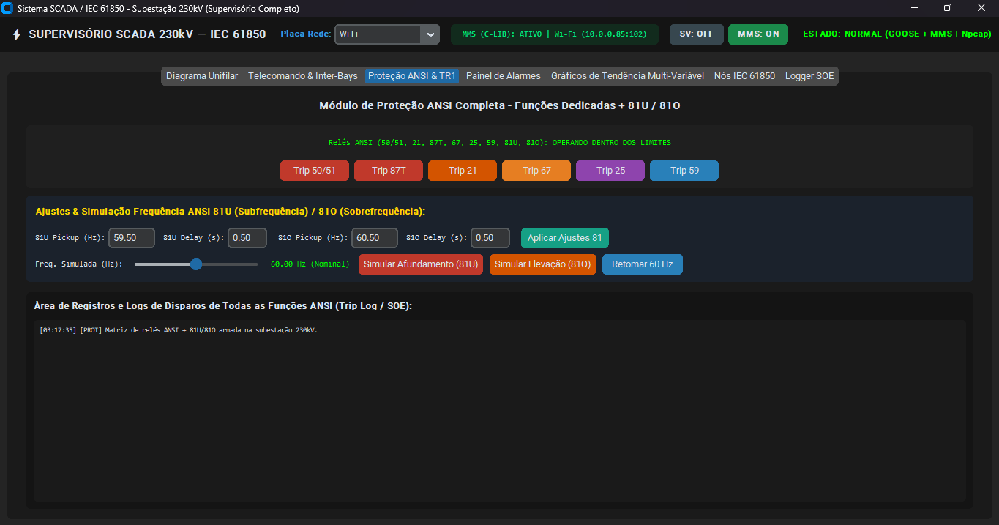

# ⚡ Supervisório para Simulação SCADA 230kV (Diário de um Comissionador - Ep. 08)

Sistema supervisório para simulação SCADA desenvolvido em Python para automação, monitoramento e controle de subestações de alta tensão (230kV), integrando lógicas de intertravamento e protocolos de comunicação do setor elétrico.

## 🚀 Tecnologias e Ferramentas
- **Linguagem:** Python
- **Interface Gráfica (GUI):** CustomTkinter (Modo Escuro / Padrão Industrial)
- **Protocolos e Redes:** IEC 61850 (GOOSE)
- **Ferramentas de Diagnóstico:** OMICRON IEDScout, Wireshark

## ⚙️ Principais Funcionalidades e Telas do Sistema

### 1. Diagrama Unifilar (Mimic Diagram)

### 2. Seleção de Placa de Rede e Interfaces Npcap

### 3. Módulo de Telecomando e Intertravamentos CILO

### 4. Módulo de Proteção ANSI & TR1

### 5. Painel de Alertas e Faltas (Annunciator)

### 6. Gráficos de Tendência Multi-Variável

### 7. Árvore de Nós Lógicos IEC 61850

### 8. Logger de Sequência de Eventos (SOE)

## 📂 Estrutura do Projeto
- `app_subestacao.py` — Código principal da aplicação gráfica e motor de regras lógicas.
- `assets/` — Pasta contendo as capturas de tela do sistema.
- `.gitignore` — Arquivos ignorados pelo controle de versão.

---
*Desenvolvido por Patrick Araujo Santana — Série: Diário de um Comissionador.*