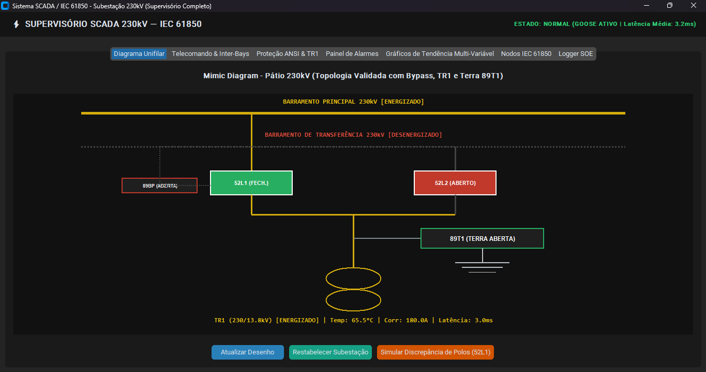
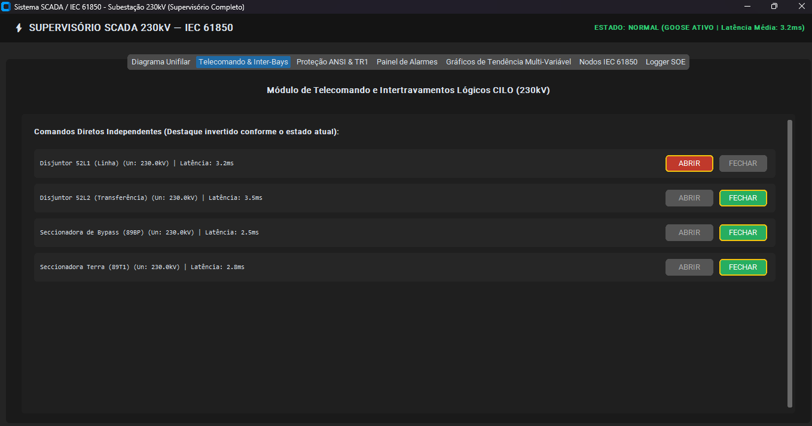
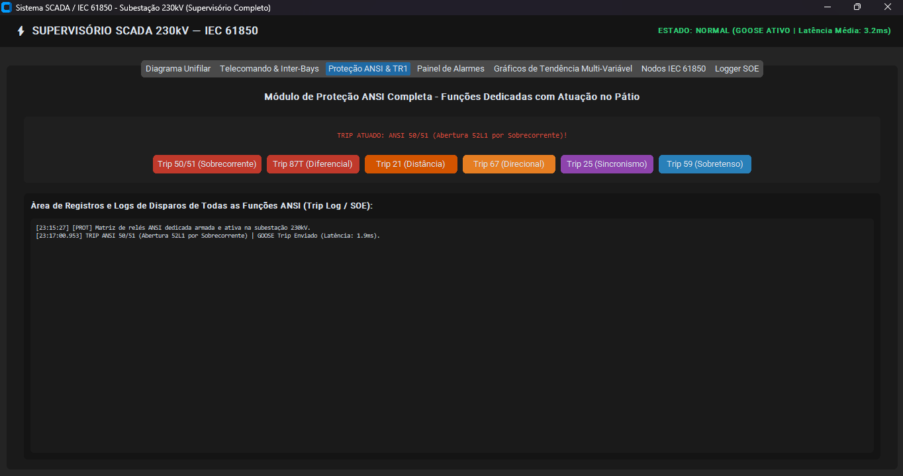
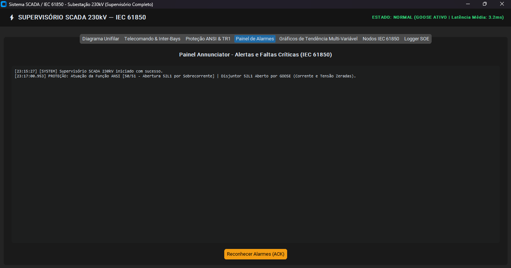
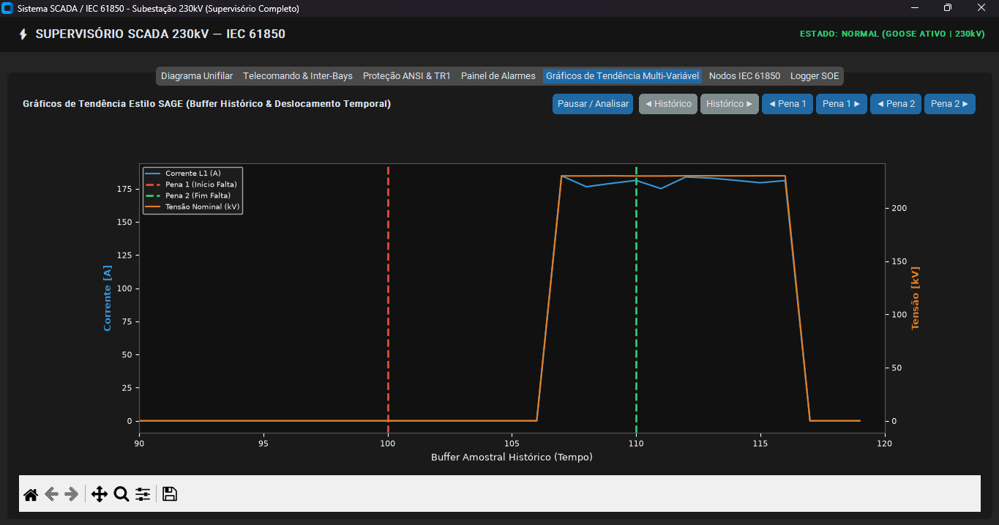
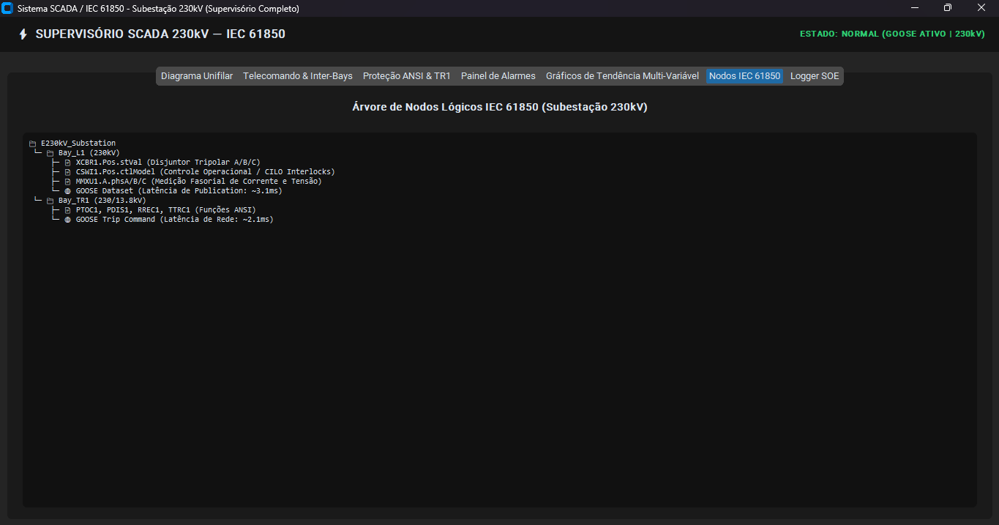
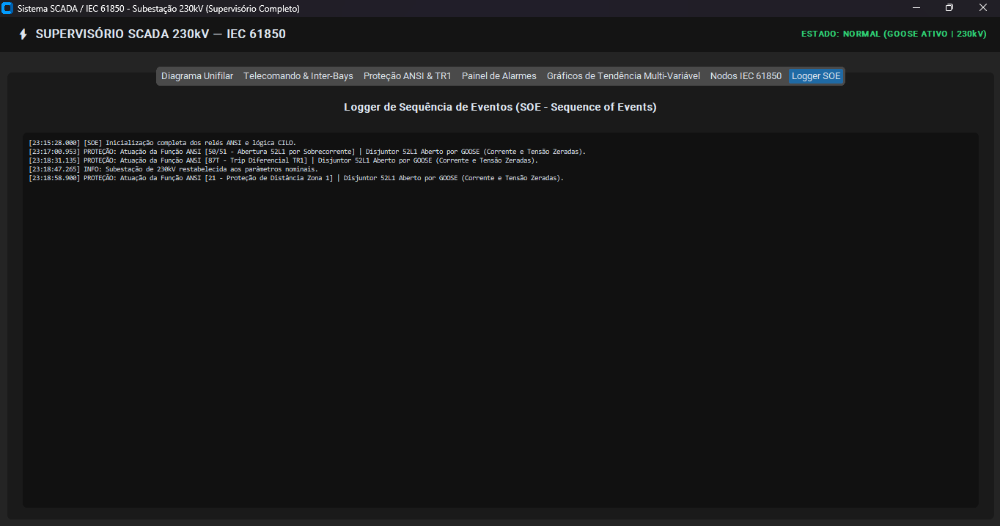

# ⚡ Supervisório SCADA 230kV para Simulação (Diário de um Comissionador - Ep. 08)

Sistema supervisório para simulação SCADA desenvolvido em Python para automação, monitoramento e controle de subestações de alta tensão (230kV), integrando lógicas de intertravamento e protocolos de comunicação do setor elétrico.

## 🚀 Tecnologias e Ferramentas
* **Linguagem:** Python
* **Interface Gráfica (GUI):** CustomTkinter (Modo Escuro / Padrão Industrial)
* **Protocolos e Redes:** IEC 61850 (GOOSE)
* **Ferramentas de Diagnóstico:** OMICRON IEDScout, Wireshark

## ⚙️ Principais Funcionalidades e Telas do Sistema

### 1. Diagrama Unifilar (Mimic Diagram)

### 2. Módulo de Telecomando e Intertravamentos CILO

### 3. Módulo de Proteção ANSI & TR1

### 4. Painel de Alertas e Faltas (Annunciator)

### 5. Gráficos de Tendência Multi-Variável

### 6. Árvore de Nodos Lógicos IEC 61850

### 7. Logger de Sequência de Eventos (SOE)

## 📂 Estrutura do Projeto
* `app_subestacao.py` — Código principal da aplicação gráfica e motor de regras lógicas.
* `assets/` — Pasta contendo as capturas de tela do sistema.
* `.gitignore` — Arquivos ignorados pelo controle de versão.

---
*Desenvolvido por Patrick Araujo Santana — Série: Diário de um Comissionador.*
