# ⚡ Supervisório para Simulação SCADA 230kV (Diário de um Comissionador - Ep. 11)

Sistema supervisório para simulação SCADA de subestação de alta tensão (230kV) desenvolvido em **Python** e **C (`libiec61850`)**, integrando lógicas de intertravamento **CILO**, funções de proteção **ANSI** (incluindo **81U** e **81O**), servidor **MMS** em C com ponte **UDP**, publicação **GOOSE** em Layer 2 (`0x88B8`), transmissão **Sampled Values** (`0x88BA`) e diagnóstico de rede via **Scapy / Npcap** e **OMICRON IEDScout**.

## 🆕 O que Mudou (Atualização Ep. 11 — `C:\SCADA_230kV`)

- **Diretório e Controle de Versão (`C:\SCADA_230kV`):**
  - Código consolidado em `C:\SCADA_230kV` com histórico Git migrado de `C:\Users\User\Documents\Códigos Python`.
  - `.gitignore` atualizado para ignorar `__pycache__/`, `*.pyc`, `build/`, `build_py/`, `dist/`, `*.spec`, `*.exe`, `*.dll` e `libiec61850/`.
- **Novo Código Principal (`scada_subestacao_230kv.py` em substituição a `app_subestacao.py`):**
  - Resolução de interfaces de rede e IPv4 ajustada para a interface **Wi-Fi** (`10.0.0.85` / `\Device\NPF_{10387399-A6F9-400E-9890-9F0F9399C719}`), evitando `0.0.0.0` ou seleção indevida de adaptador.
  - Comunicação **MMS** com o OMICRON IEDScout na VMware (`10.0.0.8`) via interface **VMnet8** no IP `192.168.199.1` (porta `102`), integrada ao servidor em C via ponte **UDP** (`127.0.0.1`, portas `50102` e `50103`).
  - Gerenciamento do processo MMS em C (`C-LIB`) com *fallback* em Python, atualização em tempo real do *badge* de status e árvore de nós lógicos IEC 61850.
  - Envio de quadros **GOOSE** (`EtherType 0x88B8`, MAC `01:0c:cd:01:00:00`) com controle de `stNum` e `sqNum` e **Sampled Values** (`EtherType 0x88BA`, MAC `01:0c:cd:04:00:01`).
  - Lógicas de intertravamento **CILO**, proteção **ANSI** (incluindo **81U** e **81O** com *pickup*, *delay* e bloqueio por ausência de tensão) e gráficos de tendência com frequência (`Hz`).
- **Servidor MMS em C e Ponte UDP (`iec61850_mms_server.c`):**
  - Servidor IEC 61850 MMS compilado com `libiec61850` integrado via ponte UDP (`127.0.0.1`, portas `50102` e `50103`) para troca de estados do bay/TR1 e recebimento de comandos remotos (`OPERATE` em `52L1`).
- **Automação de Build (`gerar_SCADA_230kV.ps1`):**
  - Script PowerShell para encerrar processos ativos, compilar/empacotar `SCADA_230kV.exe` via PyInstaller em `C:\SCADA_230kV` e incluir `iec61850_mms_server.exe`, `libiec61850.dll` e dependências.

## 🚀 Tecnologias e Ferramentas

- **Linguagens:** Python, C (`libiec61850`)
- **Interface Gráfica (GUI):** CustomTkinter, Matplotlib (Modo Escuro / Padrão Industrial)
- **Protocolos e Redes:** IEC 61850 (MMS via VMnet8 `192.168.199.1`, GOOSE `0x88B8`, Sampled Values `0x88BA`), ponte UDP (`50102`/`50103`), Scapy / Npcap
- **Ferramentas de Diagnóstico e Build:** OMICRON IEDScout, Wireshark, PyInstaller, PowerShell

## ⚙️ Principais Funcionalidades e Telas do Sistema

### 1. Diagrama Unifilar (Mimic Diagram)
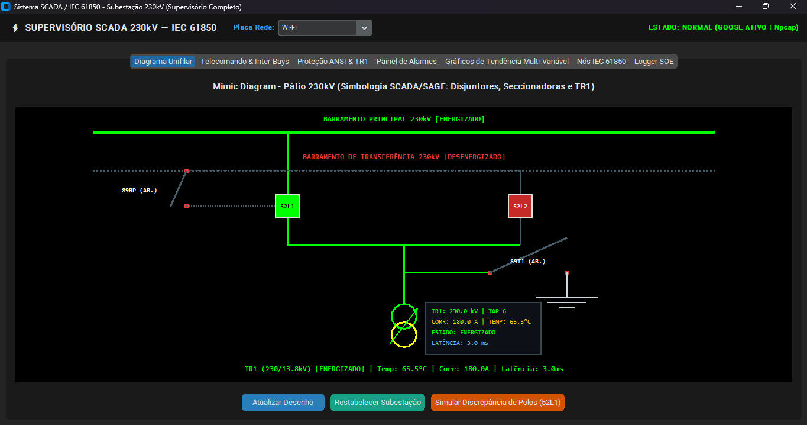

### 2. Seleção de Placa de Rede e Interfaces Npcap
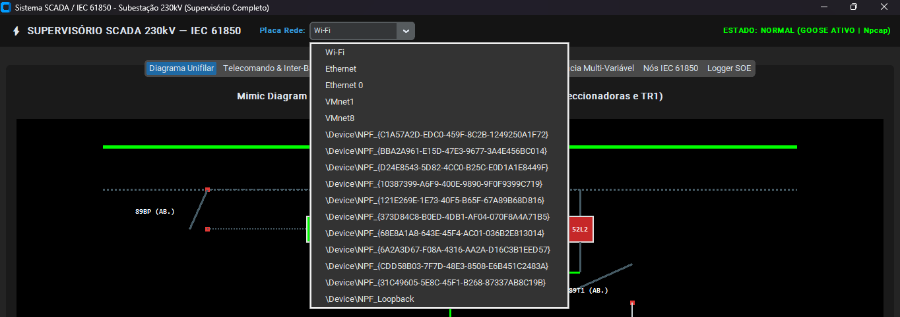

### 3. Módulo de Telecomando e Intertravamentos CILO

### 4. Módulo de Proteção ANSI & TR1

### 5. Painel de Alertas e Faltas (Annunciator)
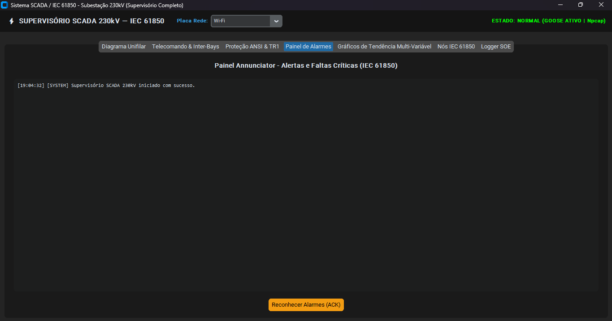

### 6. Gráficos de Tendência Multi-Variável
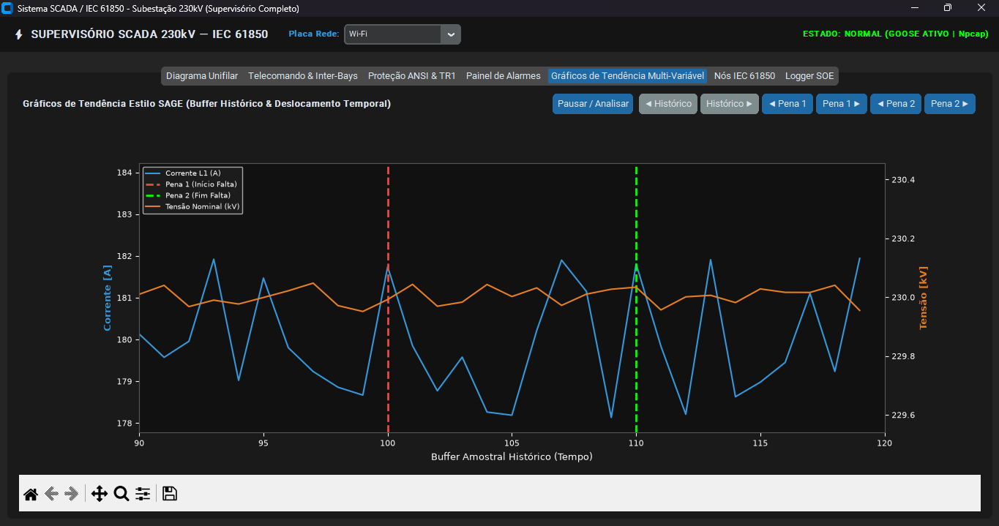

### 7. Árvore de Nós Lógicos IEC 61850
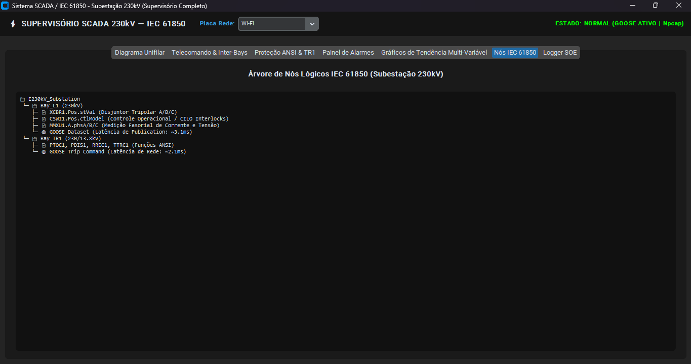

### 8. Logger de Sequência de Eventos (SOE)
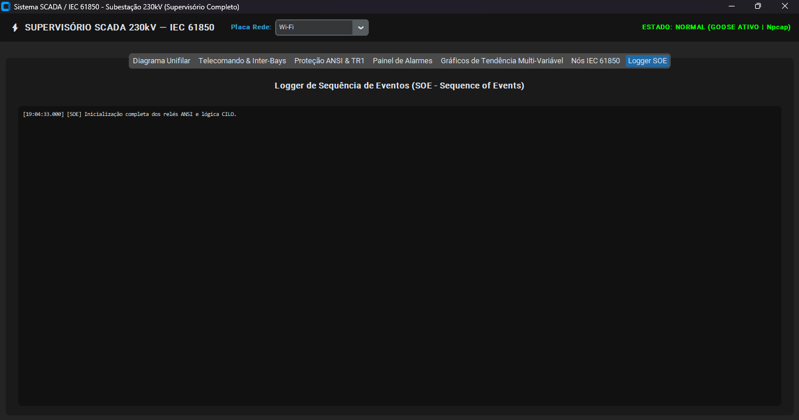

### 9. Unifilar com Interface Wi-Fi (10.0.0.85) e Servidor MMS (C-LIB) Ativo
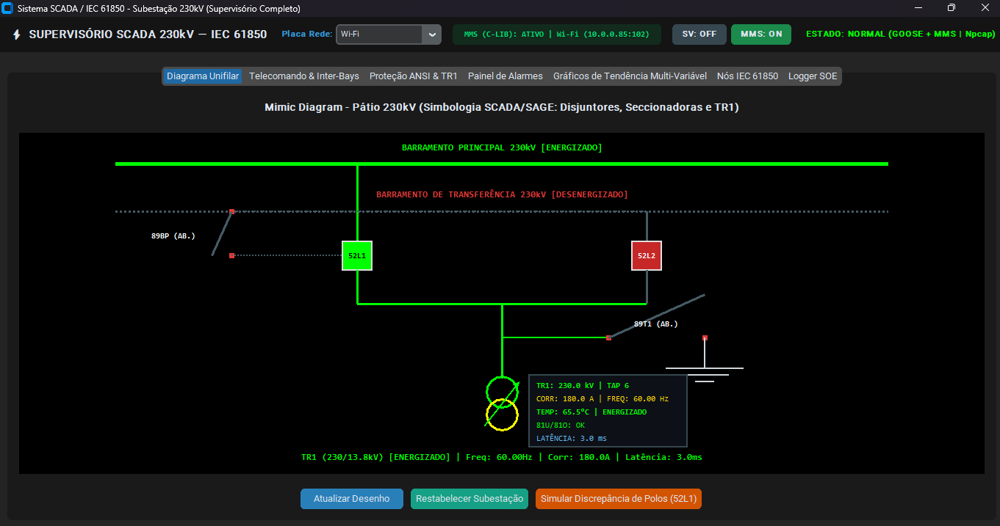

### 10. Nós Lógicos IEC 61850 e Contadores GOOSE (stNum / sqNum)
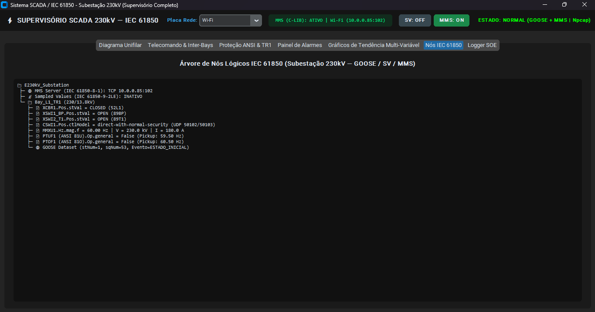

### 11. OMICRON IEDScout via MMS na VMnet8 (192.168.199.1) e Comando em 52L1
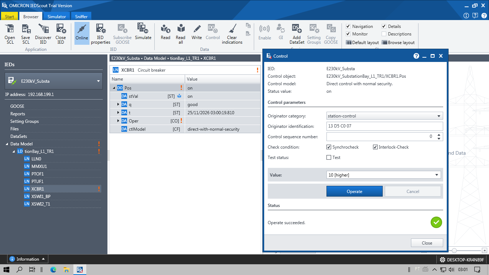

### 12. Captura GOOSE no OMICRON IEDScout (stNum e sqNum)
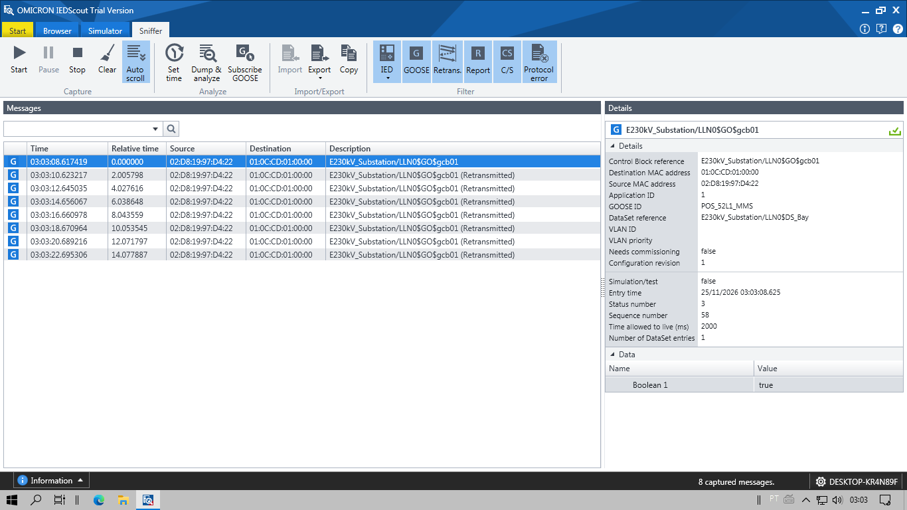

### 13. Logger SOE (Comandos Remotos IEDScout) e Gráficos de Tendência
Registro cronológico no Logger SOE dos comandos de abertura e fechamento enviados remotamente pelo OMICRON IEDScout via MMS/UDP no disjuntor `52L1`, acompanhado pelos gráficos de tendência em tempo real.

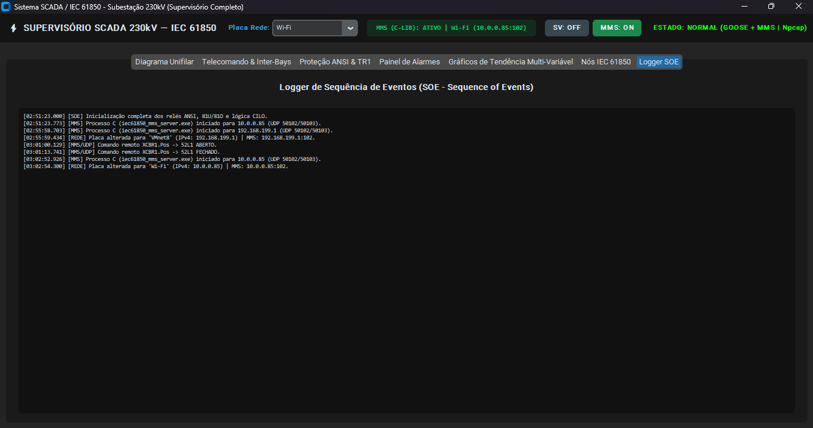

## 📂 Estrutura do Projeto (`C:\SCADA_230kV`)

- `scada_subestacao_230kv.py` — Supervisório principal, lógica CILO, proteção ANSI (`81U`/`81O`), GOOSE, SV, ponte UDP e controle do servidor MMS.
- `iec61850_mms_server.c` — Servidor IEC 61850 MMS em C (`libiec61850`) com ponte UDP (`50102`/`50103`).
- `gerar_SCADA_230kV.ps1` — Script de empacotamento com PyInstaller em `C:\SCADA_230kV`.
- `README.md` — Documentação do projeto e registro de alterações.
- `assets/` — Pasta com as imagens de referência do sistema (`01` a `13`).
- `.gitignore` — Regras de exclusão do controle de versão.
